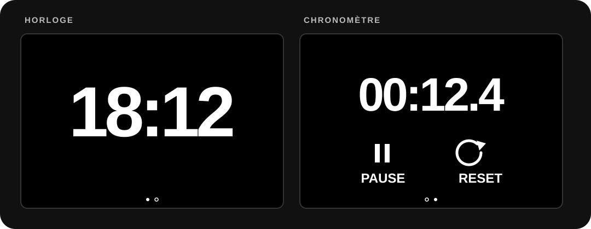

# Horloge tactile ESP32-S3

Une horloge et un chronomètre minimalistes pour l'écran tactile **Guition JC3248W535C**. Heure blanche en grand sur fond noir, deux pages, et une luminosité réduite pendant la nuit.

<p align="center">
  
</p>

> L'image est une illustration de l'interface. L'affichage réel dépend de l'écran et de la police compilée par ESPHome.

## Ce que fait le programme

- **Horloge** au format 24 h (`18:12`), synchronisée par Wi-Fi avec le fuseau `Europe/Paris` et les changements d'heure été/hiver.
- **Chronomètre** avec START, PAUSE, reprise et RESET. Le temps reste mémorisé quand on revient à la page horloge, tant que l'appareil reste alimenté.
- **Deux pages tactiles** : balayage de droite vers la gauche pour ouvrir le chrono, de gauche vers la droite pour revenir à l'horloge. Les petits points en bas permettent aussi de changer de page.
- **Mode nuit** : rétroéclairage à 2 % de 00:00 à 08:29, puis à 100 % dès 08:30. Au démarrage, il reste faible jusqu'à la synchronisation de l'heure.
- Interface blanche sur fond noir, sans animation de transition.

Une [variante à trois pages](bridge/README.md) ajoute un petit indicateur Codex en bas à gauche de l'horloge : logo, pourcentage utilisé sur la session de 5 heures et temps avant le reset. Sa page « CODEX » affiche aussi le pourcentage restant sur 5 heures et le quota hebdomadaire. Elle utilise un petit relais sur un Mac pour l'essai, puis sur un serveur local allumé en permanence ; la configuration principale à deux pages n'en a pas besoin.

## Matériel

Cette configuration a été réalisée pour la carte **JC3248W535C / JC3248W535C_I_Y** avec ESP32-S3 et écran tactile 480 × 320. Le port USB-C sert à installer le programme et à alimenter l'écran. Vérifiez la référence imprimée sur votre carte avant de flasher : une variante peut avoir des broches différentes.

Il faut aussi un réseau Wi-Fi **2,4 GHz** avec accès à Internet pour obtenir l'heure.

## Installation

Téléchargez le projet depuis GitHub (bouton **Code → Download ZIP**) ou clonez-le :

```sh
git clone https://github.com/hugo-solo/horloge-esp32-tactile.git
cd horloge-esp32-tactile
```

### macOS et Linux

Installez Python, puis dans le dossier du projet :

```sh
python3 -m venv .venv
source .venv/bin/activate
python -m pip install -r requirements.txt
cp secrets.example.yaml secrets.yaml
```

Ouvrez `secrets.yaml` et remplacez les valeurs d'exemple par le nom et le mot de passe de votre Wi-Fi. Branchez l'écran avec un câble USB-C qui transmet les données, puis lancez :

```sh
esphome run horloge.yaml
```

ESPHome compile le firmware et vous demande le port série à utiliser. La première compilation peut prendre plusieurs minutes.

### Windows (PowerShell)

```powershell
py -m venv .venv
.\.venv\Scripts\python.exe -m pip install -r requirements.txt
Copy-Item secrets.example.yaml secrets.yaml
.\.venv\Scripts\esphome.exe run horloge.yaml
```

Renseignez `secrets.yaml` avant la dernière commande. Sous Windows, si l'installation locale d'ESPHome pose problème, utilisez sa [méthode d'installation officielle](https://esphome.io/guides/installing_esphome.html).

**Ne publiez pas `secrets.yaml`** : ce fichier contient votre mot de passe Wi-Fi et est exclu du dépôt par `.gitignore`.

## Utilisation

| Geste ou bouton | Action |
| --- | --- |
| Balayer de droite vers la gauche | Ouvrir le chronomètre |
| Balayer de gauche vers la droite | Revenir à l'horloge |
| Toucher un petit point | Aller directement à cette page |
| START | Lancer ou reprendre le chronomètre |
| PAUSE | Arrêter temporairement le chronomètre |
| RESET | Arrêter et remettre à zéro |

## Réglages rapides

Les paramètres se trouvent dans [`horloge.yaml`](horloge.yaml) :

- **Fuseau horaire** : `time.timezone` (actuellement `Europe/Paris`).
- **Plage et niveau de luminosité** : script `appliquer_luminosite` et horaires dans `time.on_time`. Pour modifier l'heure de retour à pleine luminosité, changez à la fois la condition du script et l'horaire `on_time` correspondant.
- **Police et taille** : section `font`. La page horloge utilise `chiffres_gras`.

Après une modification, relancez `esphome run horloge.yaml` avec l'écran branché en USB.

## En cas de problème

- **L'écran n'apparaît pas dans la liste des ports** : essayez un autre câble USB-C, car certains câbles ne transmettent que l'alimentation.
- **`--:--` reste affiché** : vérifiez le SSID, le mot de passe et l'accès Internet du réseau Wi-Fi 2,4 GHz.
- **L'heure est incorrecte après une coupure de courant** : l'écran doit retrouver le Wi-Fi pour se resynchroniser ; cette configuration n'utilise pas d'horloge à pile indépendante.
- **Les touches ou l'affichage sont inversés** : vérifiez que la référence de votre carte correspond bien au modèle ci-dessus avant de modifier la rotation ou les axes tactiles.

## Fichiers

| Fichier | Rôle |
| --- | --- |
| [`horloge.yaml`](horloge.yaml) | Configuration ESPHome et interface |
| [`horloge-codex.yaml`](horloge-codex.yaml) | Variante à trois pages avec quotas Codex |
| [`bridge/`](bridge/README.md) | Relais de quotas pour une VM Debian/Ubuntu |
| [`secrets.example.yaml`](secrets.example.yaml) | Modèle pour les identifiants Wi-Fi |
| [`requirements.txt`](requirements.txt) | Version d'ESPHome utilisée pour ce projet |
| [`docs/apercu.svg`](docs/apercu.svg) | Illustration de l'interface |
